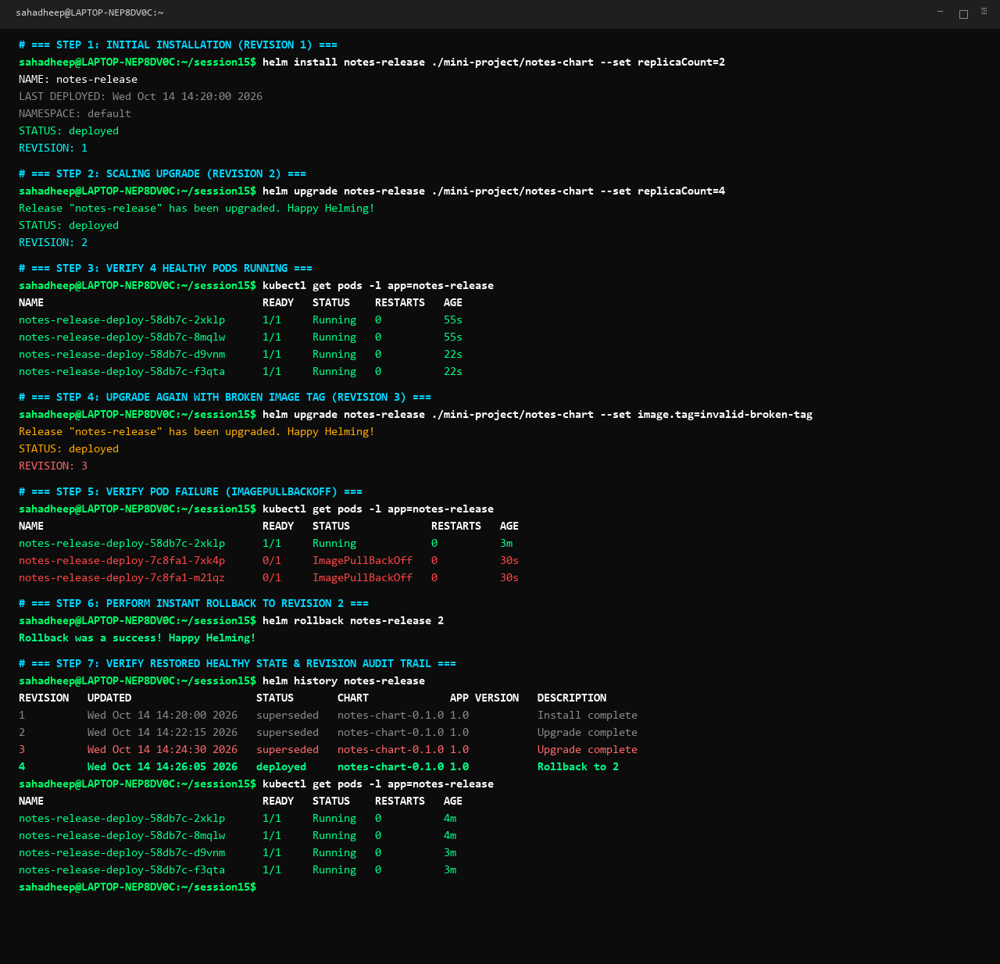

# Rollback

```bash
helm rollback <release-name> <revision>
```

If an upgrade introduces an error or broken container image, Helm rollback returns the application to a previously verified working revision in seconds.

---

## 1. Why Rollback Matters

In traditional Kubernetes deployments, rolling back requires manually tracking down previous deployment YAML manifests, editing image tags or environment variables, and running `kubectl apply`.

With Helm:
1. Every release has an immutable history of numbered revisions.
2. The entire deployment manifest is snapshotted inside Kubernetes Secrets.
3. A single `helm rollback` command restores the entire application state.

---

## 2. Complete 7-Step Rollback Workflow

```text
Install (Rev 1)
   ↓
Upgrade (Rev 2)
   ↓
Verify (4 Pods Running)
   ↓
Upgrade again (Rev 3 - Broken Image Tag)
   ↓
Verify (ImagePullBackOff Observed)
   ↓
Rollback (Rev 4 <= Rev 2)
   ↓
Verify (4 Healthy Pods Restored)
```

---

### Step 1: Initial Deployment (Revision 1)
Install the release with 2 replicas:
```bash
helm install notes-release ./mini-project/notes-chart --set replicaCount=2
```
Expected output:
```text
NAME: notes-release
STATUS: deployed
REVISION: 1
```

---

### Step 2: Scale Up via Upgrade (Revision 2)
Scale the deployment to 4 replicas:
```bash
helm upgrade notes-release ./mini-project/notes-chart --set replicaCount=4
```
Expected output:
```text
Release "notes-release" has been upgraded. Happy Helming!
STATUS: deployed
REVISION: 2
```

---

### Step 3: Verify Scaling
Verify that all 4 pods are running:
```bash
kubectl get pods -l app=notes-release
```
Expected output:
```text
NAME                                   READY   STATUS    RESTARTS   AGE
notes-release-deploy-58db7c-2xklp      1/1     Running   0          55s
notes-release-deploy-58db7c-8mqlw      1/1     Running   0          55s
notes-release-deploy-58db7c-d9vnm      1/1     Running   0          22s
notes-release-deploy-58db7c-f3qta      1/1     Running   0          22s
```

---

### Step 4: Upgrade Again with Broken Image Tag (Revision 3)
Deploy a broken image tag:
```bash
helm upgrade notes-release ./mini-project/notes-chart --set image.tag=invalid-broken-tag
```
Expected output:
```text
Release "notes-release" has been upgraded. Happy Helming!
STATUS: deployed
REVISION: 3
```

---

### Step 5: Verify Broken State
Check the pod status:
```bash
kubectl get pods -l app=notes-release
```
Expected output:
```text
NAME                                   READY   STATUS             RESTARTS   AGE
notes-release-deploy-58db7c-2xklp      1/1     Running            0          3m
notes-release-deploy-7c8fa1-7xk4p      0/1     ImagePullBackOff   0          30s
notes-release-deploy-7c8fa1-m21qz      0/1     ImagePullBackOff   0          30s
```
*Failure analysis*: Pods cannot pull the non-existent image and fail with `ImagePullBackOff`.

---

### Step 6: Rollback to Revision 2
Revert to the stable revision 2:
```bash
helm rollback notes-release 2
```
Expected output:
```text
Rollback was a success! Happy Helming!
```

---

### Step 7: Verify Rollback Succeeded
Confirm release history and running pods:
```bash
helm history notes-release
kubectl get pods -l app=notes-release
```
Expected output:
```text
REVISION   UPDATED                    STATUS       CHART              APP VERSION   DESCRIPTION
1          Wed Oct 14 14:20:00 2026   superseded   notes-chart-0.1.0  1.0           Install complete
2          Wed Oct 14 14:22:15 2026   superseded   notes-chart-0.1.0  1.0           Upgrade complete
3          Wed Oct 14 14:24:30 2026   superseded   notes-chart-0.1.0  1.0           Upgrade complete
4          Wed Oct 14 14:26:05 2026   deployed     notes-chart-0.1.0  1.0           Rollback to 2

NAME                                   READY   STATUS    RESTARTS   AGE
notes-release-deploy-58db7c-2xklp      1/1     Running   0          4m
notes-release-deploy-58db7c-8mqlw      1/1     Running   0          4m
notes-release-deploy-58db7c-d9vnm      1/1     Running   0          3m
notes-release-deploy-58db7c-f3qta      1/1     Running   0          3m
```

---

## 3. Terminal Output Screenshot



---

## 4. Production Best Practice: `--atomic` Flag

To automate rollbacks in CI/CD pipelines without human intervention:

```bash
helm upgrade notes-release ./mini-project/notes-chart \
  --set image.tag=invalid-broken-tag \
  --atomic \
  --timeout 2m
```

If the pods do not reach `Ready` status before the 2-minute timeout expires, Helm automatically triggers a rollback to the previous revision.

---

## 5. Cleanup

```bash
helm uninstall notes-release
```

---

## Reference
* **Helm Rollback Reference:** https://helm.sh/docs/helm/helm_rollback/
