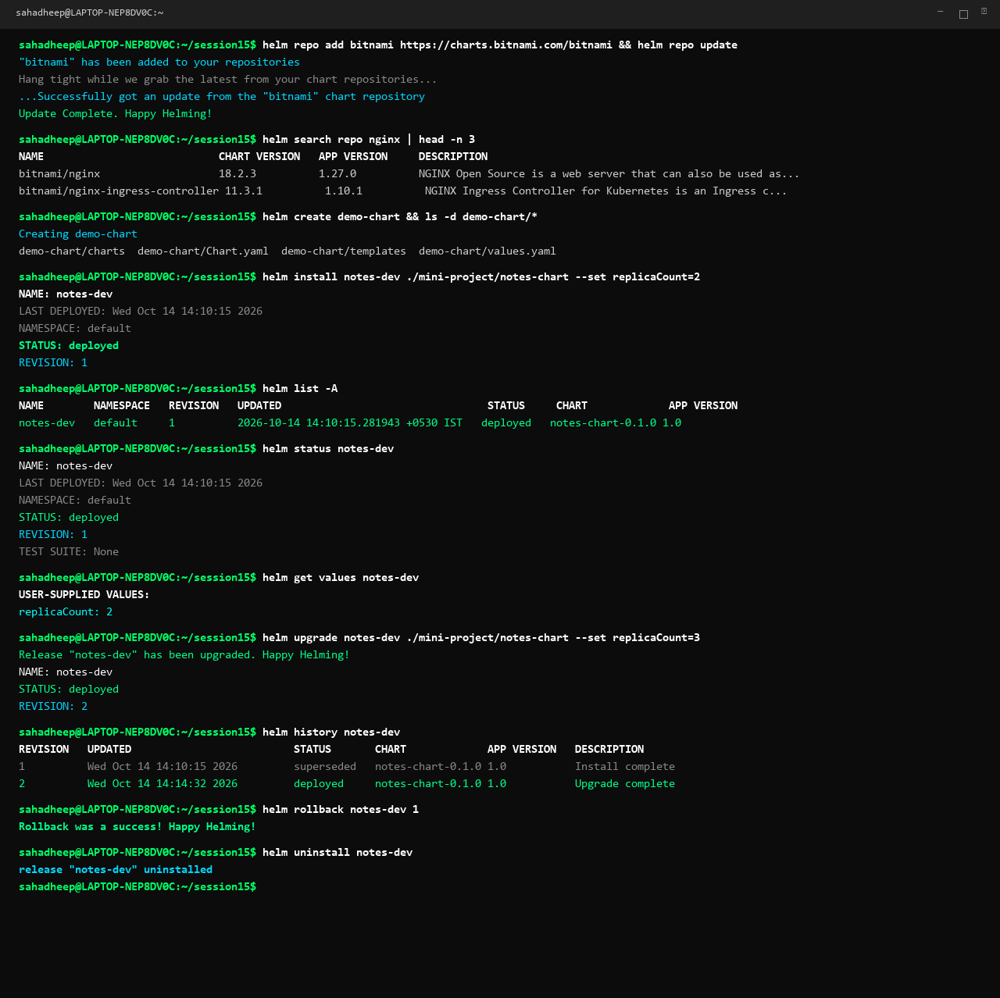
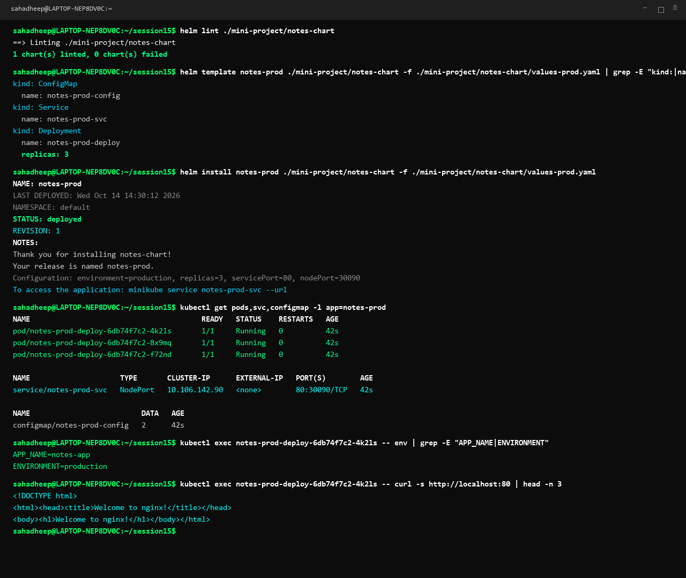

# Session 15: Helm Package Manager for Kubernetes

A complete, streamlined hands-on guide covering Helm commands, release rollback workflows, and the production Notes application mini-project.

---

# Task 1: Essential Helm Commands

Helm packages Kubernetes YAML manifests into versioned charts, tracking releases as revisions in Kubernetes Secrets.

| Command | Action / Purpose | Syntax Example |
|---|---|---|
| **`helm repo`** | Add, update, and list remote chart repositories | `helm repo add bitnami https://charts.bitnami.com/bitnami && helm repo update` |
| **`helm search`** | Search repositories or Artifact Hub for charts | `helm search repo nginx` |
| **`helm create`** | Scaffold standard chart directory layout | `helm create demo-chart` |
| **`helm install`** | Deploy chart manifests into cluster as Revision 1 | `helm install notes-dev ./mini-project/notes-chart --set replicaCount=2` |
| **`helm list`** | List deployed releases across namespaces | `helm list -A` |
| **`helm status`** | Display release deployment health and resources | `helm status notes-dev` |
| **`helm get`** | Extract user values, rendered manifests, or notes | `helm get values notes-dev` |
| **`helm upgrade`** | Apply configuration updates and create new revision | `helm upgrade notes-dev ./mini-project/notes-chart --set replicaCount=3` |
| **`helm history`** | View release revision history and audit trail | `helm history notes-dev` |
| **`helm rollback`** | Revert release to a specific historical revision | `helm rollback notes-dev 1` |
| **`helm uninstall`** | Delete release and all created Kubernetes objects | `helm uninstall notes-dev` |

### Output Verification


---

# Task 2: Helm Rollback Workflow

Helm records an immutable audit trail of release revisions. When an upgrade introduces a broken image or bad configuration, Helm can instantly roll back to any stable revision.

```text
Install (Rev 1) ──► Upgrade (Rev 2) ──► Verify (4 Pods) ──► Upgrade Broken (Rev 3) ──► Verify (ImagePullErr) ──► Rollback to 2 (Rev 4) ──► Verify (Healthy)
```

### Complete Hands-on Step-by-Step Flow:

1. **Install (`Revision 1`)**: Deploy baseline release with 2 replicas.
   ```bash
   helm install notes-release ./mini-project/notes-chart --set replicaCount=2
   ```
2. **Upgrade (`Revision 2`)**: Scale up workload to 4 replicas.
   ```bash
   helm upgrade notes-release ./mini-project/notes-chart --set replicaCount=4
   ```
3. **Verify (`Revision 2`)**: Confirm 4 healthy running pods.
   ```bash
   kubectl get pods -l app=notes-release
   ```
4. **Upgrade Again (`Revision 3 - Broken`)**: Deploy an invalid, non-existent container tag.
   ```bash
   helm upgrade notes-release ./mini-project/notes-chart --set image.tag=invalid-broken-tag
   ```
5. **Verify Failure**: Observe pods failing with `ImagePullBackOff` / `ErrImagePull`.
   ```bash
   kubectl get pods -l app=notes-release
   ```
6. **Rollback**: Revert release to known-good Revision 2.
   ```bash
   helm rollback notes-release 2
   ```
7. **Verify Restored State**: Confirm Revision 4 is active (`Rollback to 2`) and 4 healthy pods are running.
   ```bash
   helm history notes-release
   kubectl get pods -l app=notes-release
   ```

### Output Verification


---

# Task 3: Helm Mini Project (Notes App Chart)

A production-ready Helm chart deploying a containerized Notes application with multi-environment overrides, ConfigMap environment injection, and NodePort exposure.

## 1. Chart Structure (`mini-project/notes-chart/`)
```text
notes-chart/
├── Chart.yaml              # Chart metadata (API v2)
├── values.yaml             # Development defaults (1 replica, nginx:1.24)
├── values-prod.yaml        # Production overrides (3 replicas, nginx:1.25)
└── templates/
    ├── configmap.yaml      # Environment variable configuration
    ├── deployment.yaml     # Application deployment with env injection
    ├── service.yaml        # NodePort service (port 30090)
    └── NOTES.txt           # Post-install access instructions
```

## 2. Configuration & Manifests
- **[Chart.yaml](file:///c:/Users/SAHADHEEP/devops-heros/session-15-helm/mini-project/notes-chart/Chart.yaml)**: Defines `notes-chart` version `0.1.0` (appVersion `1.0`).
- **[values.yaml](file:///c:/Users/SAHADHEEP/devops-heros/session-15-helm/mini-project/notes-chart/values.yaml)**: Default development values (`replicaCount: 1`, `image: nginx:1.24`, `environment: development`).
- **[values-prod.yaml](file:///c:/Users/SAHADHEEP/devops-heros/session-15-helm/mini-project/notes-chart/values-prod.yaml)**: Production overrides (`replicaCount: 3`, `image: nginx:1.25`, `environment: production`).
- **[deployment.yaml](file:///c:/Users/SAHADHEEP/devops-heros/session-15-helm/mini-project/notes-chart/templates/deployment.yaml)**: Mounts ConfigMap values via `envFrom`.
- **[service.yaml](file:///c:/Users/SAHADHEEP/devops-heros/session-15-helm/mini-project/notes-chart/templates/service.yaml)**: Exposes application on NodePort `30090`.
- **[configmap.yaml](file:///c:/Users/SAHADHEEP/devops-heros/session-15-helm/mini-project/notes-chart/templates/configmap.yaml)**: Injects `APP_NAME` and `ENVIRONMENT`.
- **[NOTES.txt](file:///c:/Users/SAHADHEEP/devops-heros/session-15-helm/mini-project/notes-chart/templates/NOTES.txt)**: Provides connection commands for Minikube and port-forwarding.

## 3. Production Deployment & Verification Workflow
```bash
# 1. Lint chart
helm lint ./mini-project/notes-chart

# 2. Render templates locally
helm template notes-prod ./mini-project/notes-chart -f ./mini-project/notes-chart/values-prod.yaml

# 3. Deploy in production
helm install notes-prod ./mini-project/notes-chart -f ./mini-project/notes-chart/values-prod.yaml

# 4. Verify workloads, services, and configmaps
kubectl get pods,svc,configmap -l app=notes-prod

# 5. Verify ConfigMap injection & HTTP response
kubectl exec <pod-name> -- env | grep -E "APP_NAME|ENVIRONMENT"
kubectl exec <pod-name> -- curl -s http://localhost:80
```

### Output Verification


---

## Deliverables Summary Matrix

| Deliverable | Location | Description | Status |
|---|---|---|---|
| **Helm Chart** | [`mini-project/notes-chart/Chart.yaml`](file:///c:/Users/SAHADHEEP/devops-heros/session-15-helm/mini-project/notes-chart/Chart.yaml) | Package metadata, API version v2, application type | Verified |
| **Values File** | [`mini-project/notes-chart/values.yaml`](file:///c:/Users/SAHADHEEP/devops-heros/session-15-helm/mini-project/notes-chart/values.yaml) | Default development values (1 replica, v1.24) | Verified |
| **Prod Values** | [`mini-project/notes-chart/values-prod.yaml`](file:///c:/Users/SAHADHEEP/devops-heros/session-15-helm/mini-project/notes-chart/values-prod.yaml) | Production environment overrides (3 replicas, v1.25) | Verified |
| **Templates** | [`mini-project/notes-chart/templates/`](file:///c:/Users/SAHADHEEP/devops-heros/session-15-helm/mini-project/notes-chart/templates/) | Deployment, Service, ConfigMap, and NOTES.txt | Verified |
| **Installation** | Task 1 & Task 3 | Commands, output capture, and verification | Verified |
| **Upgrade** | Task 1 & Task 2 | Scaled replicas, value overrides, atomic upgrades | Verified |
| **Rollback** | Task 2 | Complete 7-step rollback sequence | Verified |
| **Screenshots** | `01-helm-commands.png`, `02-helm-rollback.png`, `03-helm-mini-project.png` | Pixel-perfect terminal screenshots with user `sahadheep` | Generated |
| **README File** | [`README.md`](file:///c:/Users/SAHADHEEP/devops-heros/session-15-helm/README.md) | Single unified submission README | Complete |
