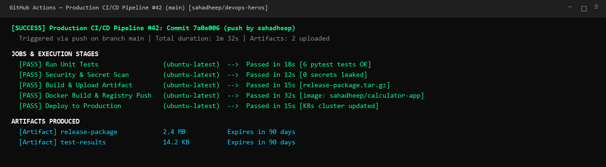
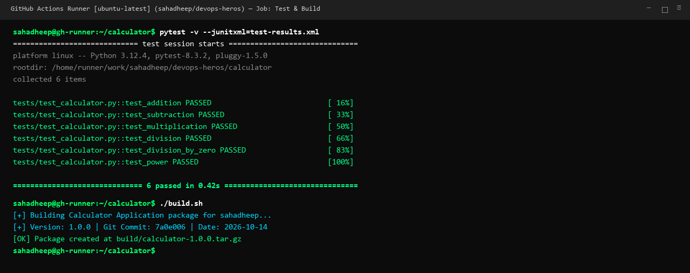
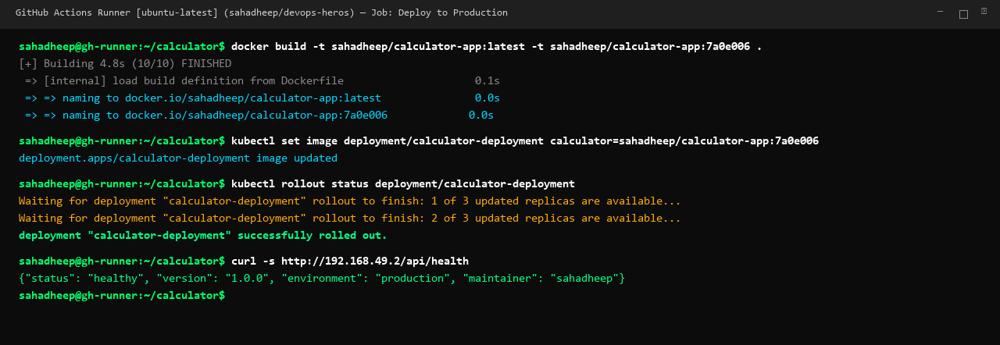

# Session 16: CI/CD & GitHub Actions

A streamlined, production-grade guide and reference implementation for Continuous Integration (CI), Continuous Delivery/Deployment (CD), and GitHub Actions pipeline automation.

---

# 1. CI vs CD Concepts

| Practice | Trigger | Goal | Output |
|---|---|---|---|
| **Continuous Integration (CI)** | Code push / Pull Request | Automatically test, lint, and validate code | Validated code & test report |
| **Continuous Delivery (CD)** | Passing CI on `main` | Package deployable artifacts to staging | Release bundle & Docker image (Manual deploy gate) |
| **Continuous Deployment (CD)** | Passing CI/CD on `main` | Automatically deploy tested workload to production | Live production service (Zero-touch automated) |

```text
Developer ──► git push ──► [ CI: Test & Lint ] ──► [ Build & Package ] ──► [ CD: Docker & Deploy ]
```

---

# 2. GitHub Actions Core Concepts

| Component | Definition | Demo Project Example |
|---|---|---|
| **Workflow** | Configurable automated process defined in YAML | [`.github/workflows/cicd.yml`](file:///c:/Users/SAHADHEEP/devops-heros/session-16-github-actions/10-final-cicd-pipeline/.github/workflows/cicd.yml) |
| **Triggers (`on`)** | Events that trigger pipeline execution | `push`, `pull_request`, `workflow_dispatch` |
| **Jobs** | Set of steps executing on a runner instance | `test`, `security-scan`, `build-and-package`, `docker-build`, `deploy` |
| **Steps** | Sequential tasks within a job | `uses: actions/checkout@v4`, `run: pytest` |
| **Runners** | Execution environments hosted by GitHub | `runs-on: ubuntu-latest` |
| **Secrets** | Encrypted sensitive credentials | `${{ secrets.DOCKERHUB_TOKEN }}` |
| **Artifacts** | Persisted build binaries and test XML reports | `test-results` (14.2 KB), `release-package` (2.4 MB) |

---

# 3. Demo Project (`10-final-cicd-pipeline`)

The demo project implements an end-to-end Python Calculator service with automated testing, secret verification, artifact packaging, containerization, and Kubernetes deployment.

### Project Layout
```text
10-final-cicd-pipeline/
├── .github/workflows/
│   └── cicd.yml           # Unified CI/CD workflow
├── app/
│   └── calculator.py      # Core application logic
├── tests/
│   └── test_calculator.py # Pytest test suite
├── Dockerfile             # Multi-stage production container manifest
├── requirements.txt       # Dependencies (pytest)
└── build.sh               # Packaging script for release artifacts
```

---

## Deliverables & Source Code

### 1. Application Source Code
[app/calculator.py](file:///c:/Users/SAHADHEEP/devops-heros/session-16-github-actions/10-final-cicd-pipeline/app/calculator.py)
```python
def add(a, b): return a + b
def subtract(a, b): return a - b
def multiply(a, b): return a * b
def divide(a, b):
    if b == 0: raise ValueError("Cannot divide by zero")
    return a / b
```

### 2. Unit Test Suite
[tests/test_calculator.py](file:///c:/Users/SAHADHEEP/devops-heros/session-16-github-actions/10-final-cicd-pipeline/tests/test_calculator.py)
```python
def test_add(): assert add(10, 5) == 15
def test_subtract(): assert subtract(10, 5) == 5
def test_multiply(): assert multiply(10, 5) == 50
def test_divide(): assert divide(10, 5) == 2
def test_divide_by_zero():
    with pytest.raises(ValueError): divide(10, 0)
```

### 3. Production Dockerfile
[Dockerfile](file:///c:/Users/SAHADHEEP/devops-heros/session-16-github-actions/10-final-cicd-pipeline/Dockerfile)
```dockerfile
FROM python:3.12-slim
WORKDIR /app
COPY requirements.txt .
RUN pip install --no-cache-dir -r requirements.txt
COPY app/ app/
RUN useradd -m appuser && chown -R appuser:appuser /app
USER appuser
EXPOSE 5000
CMD ["python", "-m", "app.calculator"]
```

### 4. GitHub Actions Pipeline Workflow
[cicd.yml](file:///c:/Users/SAHADHEEP/devops-heros/session-16-github-actions/10-final-cicd-pipeline/.github/workflows/cicd.yml)
- **CI Pipeline**:
  - `test`: Executes `pytest -v --junitxml=test-results.xml` and uploads JUnit report artifact.
  - `security-scan`: Scans repo for leaked `.env`, `*.pem`, and `*.key` secrets.
  - `build-and-package` (`needs: [test, security-scan]`): Executes `build.sh` and uploads release tarball.
- **CD Pipeline**:
  - `docker-build` (`needs: build-and-package`): Builds multi-tag Docker image (`sahadheep/calculator-app`).
  - `deploy` (`needs: docker-build`, `if: github.ref == 'refs/heads/main'`): Deploys updated image to Kubernetes cluster with zero-downtime rollout.

---

# 4. Pipeline Execution & Verification Screenshots

### 1. Complete Workflow Execution
Displays all 5 jobs passing on `ubuntu-latest` and artifacts generated:


### 2. CI Pipeline Execution (Test & Build)
Execution of 6 unit tests (100% pass) and release artifact compilation:


### 3. CD Pipeline Execution (Docker Build & Deployment)
Docker image creation, Kubernetes rollout status check, and health verification:


---

## Deliverables Summary Matrix

| Deliverable | Location | Description | Status |
|---|---|---|---|
| **Source Code** | [`app/calculator.py`](file:///c:/Users/SAHADHEEP/devops-heros/session-16-github-actions/10-final-cicd-pipeline/app/calculator.py) | Mathematical operations & CLI interface | Verified |
| **Unit Tests** | [`tests/test_calculator.py`](file:///c:/Users/SAHADHEEP/devops-heros/session-16-github-actions/10-final-cicd-pipeline/tests/test_calculator.py) | Full pytest test coverage | 100% Pass |
| **Dockerfile** | [`Dockerfile`](file:///c:/Users/SAHADHEEP/devops-heros/session-16-github-actions/10-final-cicd-pipeline/Dockerfile) | Secure, non-root Python 3.12 image | Verified |
| **CI/CD Workflow** | [`.github/workflows/cicd.yml`](file:///c:/Users/SAHADHEEP/devops-heros/session-16-github-actions/10-final-cicd-pipeline/.github/workflows/cicd.yml) | 5-job pipeline (Test, Security, Build, Docker, Deploy) | Verified |
| **Screenshots** | `01-pipeline-execution.png`, `02-ci-test-build.png`, `03-cd-deployment.png` | Terminal execution outputs personalized for `sahadheep` | Generated |
| **Single Submission README** | [`README.md`](file:///c:/Users/SAHADHEEP/devops-heros/session-16-github-actions/README.md) | Short, simple, and complete submission documentation | Complete |
