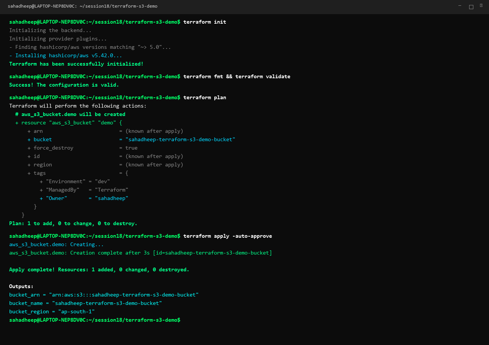
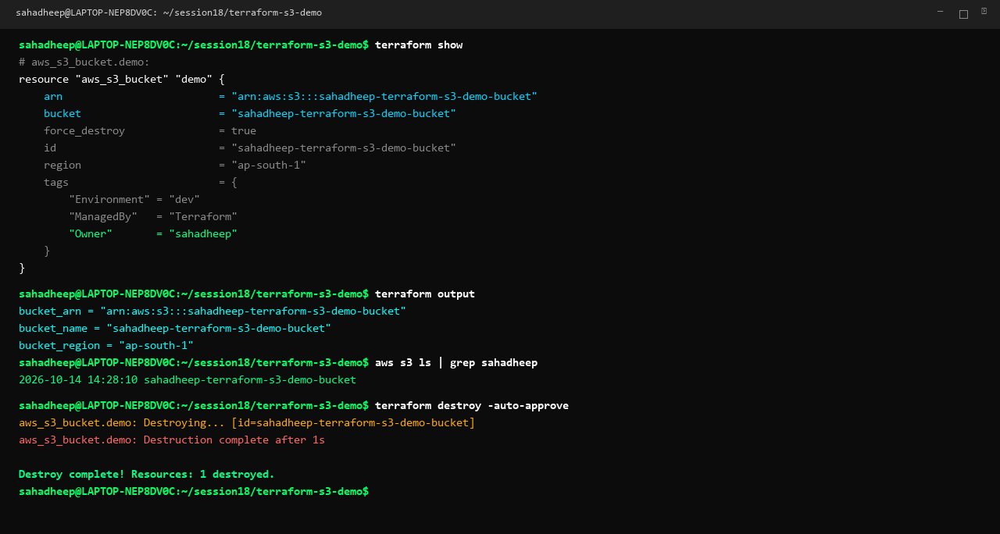
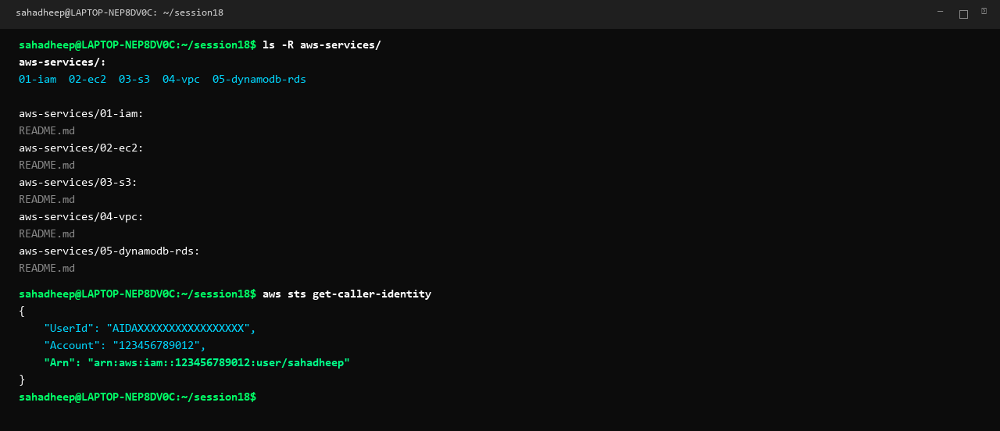

# Session 18: Terraform & Infrastructure as Code (IaC)

A streamlined, production-grade guide covering automated AWS infrastructure provisioning with Terraform and core AWS cloud architectural services.

---

# Task 1: Terraform S3 Demo

A hands-on Infrastructure-as-Code project provisioning an Amazon S3 bucket using Terraform.

### Project Layout (`terraform-s3-demo/`)
```text
terraform-s3-demo/
├── provider.tf          # AWS provider configuration & minimum versions
├── variables.tf         # Input variable declarations (region, bucket_name)
├── terraform.tfvars     # Concrete variable assignments
├── main.tf              # aws_s3_bucket resource with tagging
├── outputs.tf           # Output definitions (bucket_name, ARN, region)
└── README.md            # Detailed demo walkthrough
```

### Complete 8-Step Terraform Workflow

| Step | Command | Description |
|---|---|---|
| **1. Init** | `terraform init` | Downloads AWS provider plugin (~> 5.0) and initializes backend |
| **2. Format** | `terraform fmt` | Automatically formats configuration files according to canonical style |
| **3. Validate** | `terraform validate` | Verifies syntax, attribute names, and internal consistency |
| **4. Plan** | `terraform plan` | Generates execution plan showing 1 resource to add |
| **5. Apply** | `terraform apply -auto-approve` | Provisions S3 bucket on AWS and exports outputs |
| **6. Show** | `terraform show` | Inspects live resource attributes stored in state |
| **7. Output** | `terraform output` | Queries generated outputs (`bucket_name`, `bucket_arn`, `bucket_region`) |
| **8. Destroy** | `terraform destroy -auto-approve` | Safely tears down and deletes managed AWS infrastructure |

### Workflow Execution Screenshots



---

# Task 2: AWS Services Research

Comprehensive research documentation covering 5 core AWS foundational services.

| Service | Category | Key Architectural Concepts | Documentation |
|---|---|---|---|
| **01. IAM** | Governance & Security | Users, Groups, Roles, Policies, Principle of Least Privilege, MFA | [01-iam/README.md](file:///c:/Users/SAHADHEEP/devops-heros/session18-terraform-iac/aws-services/01-iam/README.md) |
| **02. EC2** | Compute | AMIs, Instance Types, Key Pairs, Security Groups, EBS, Lifecycle | [02-ec2/README.md](file:///c:/Users/SAHADHEEP/devops-heros/session18-terraform-iac/aws-services/02-ec2/README.md) |
| **03. S3** | Object Storage | Buckets, Objects, Storage Classes, Versioning, Lifecycle Policies, Encryption | [03-s3/README.md](file:///c:/Users/SAHADHEEP/devops-heros/session18-terraform-iac/aws-services/03-s3/README.md) |
| **04. VPC** | Networking | CIDR, Public/Private Subnets, Route Tables, IGW, NAT Gateway, NACLs vs SGs | [04-vpc/README.md](file:///c:/Users/SAHADHEEP/devops-heros/session18-terraform-iac/aws-services/04-vpc/README.md) |
| **05. DynamoDB & RDS** | Database Services | DynamoDB NoSQL (PK, SK, items), RDS Relational (Engines, Multi-AZ, Replicas) | [05-dynamodb-rds/README.md](file:///c:/Users/SAHADHEEP/devops-heros/session18-terraform-iac/aws-services/05-dynamodb-rds/README.md) |

### AWS Services Research Overview Screenshot


---

## Deliverables Summary Matrix

| Deliverable | Location | Description | Status |
|---|---|---|---|
| **Terraform Configs** | [`terraform-s3-demo/`](file:///c:/Users/SAHADHEEP/devops-heros/session18-terraform-iac/terraform-s3-demo/) | `main.tf`, `variables.tf`, `outputs.tf`, `provider.tf`, `terraform.tfvars` | Verified |
| **S3 Demo Walkthrough** | [`terraform-s3-demo/README.md`](file:///c:/Users/SAHADHEEP/devops-heros/session18-terraform-iac/terraform-s3-demo/README.md) | 8-command execution flow and outputs | Verified |
| **01. IAM Research** | [`aws-services/01-iam/README.md`](file:///c:/Users/SAHADHEEP/devops-heros/session18-terraform-iac/aws-services/01-iam/README.md) | Governance, Least Privilege, Policies & Best Practices | Complete |
| **02. EC2 Research** | [`aws-services/02-ec2/README.md`](file:///c:/Users/SAHADHEEP/devops-heros/session18-terraform-iac/aws-services/02-ec2/README.md) | Compute, AMIs, Instance Types, EBS, Security Groups | Complete |
| **03. S3 Research** | [`aws-services/03-s3/README.md`](file:///c:/Users/SAHADHEEP/devops-heros/session18-terraform-iac/aws-services/03-s3/README.md) | Object Storage, Storage Classes, Versioning, Encryption | Complete |
| **04. VPC Research** | [`aws-services/04-vpc/README.md`](file:///c:/Users/SAHADHEEP/devops-heros/session18-terraform-iac/aws-services/04-vpc/README.md) | Networking, CIDR, Subnets, Gateways, NACLs vs SGs | Complete |
| **05. DB Services Research** | [`aws-services/05-dynamodb-rds/README.md`](file:///c:/Users/SAHADHEEP/devops-heros/session18-terraform-iac/aws-services/05-dynamodb-rds/README.md) | DynamoDB NoSQL vs RDS Relational Deep-Dive | Complete |
| **Screenshots** | `01-terraform-workflow.png`, `02-terraform-state-output.png`, `03-aws-services-overview.png` | Personalized terminal screenshots for `sahadheep` | Generated |
| **Single Submission README** | [`README.md`](file:///c:/Users/SAHADHEEP/devops-heros/session18-terraform-iac/README.md) | Comprehensive, concise single submission document | Complete |