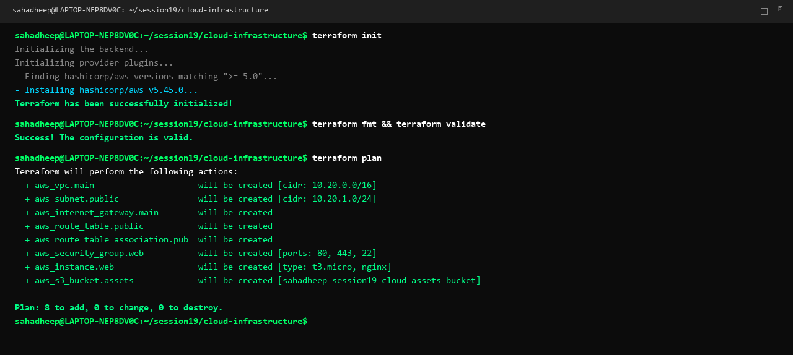
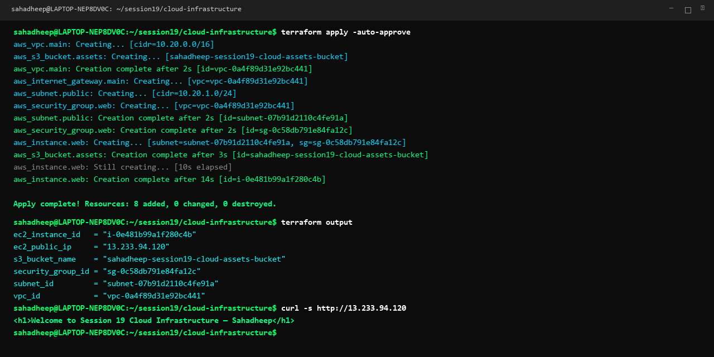
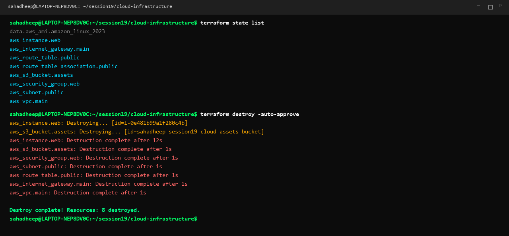

# Session 19: Cloud & Terraform in Action

An end-to-end cloud infrastructure project built using Terraform on AWS demonstrating providers, variables, resources, outputs, dependencies, state management, and the full Terraform lifecycle.

---

## Architecture Flow

```text
Terraform ──► VPC (10.20.0.0/16) ──► Subnet (10.20.1.0/24) ──► Security Group (80, 22) ──► EC2 Web Server ──► S3 Bucket
```

---

## Core Terraform Concepts

| Concept | File / Implementation | Description |
|---|---|---|
| **Providers** | [`versions.tf`](08-mini-project/versions.tf) | Configures the AWS provider (`hashicorp/aws`) and region (`ap-south-1`). |
| **Variables** | [`variables.tf`](08-mini-project/variables.tf), [`terraform.tfvars`](08-mini-project/terraform.tfvars) | Parameterizes region, instance type (`t3.micro`), and S3 bucket name. |
| **Resources** | [`main.tf`](08-mini-project/main.tf) | Provisions VPC, Subnet, IGW, Route Table, Security Group, EC2, and S3. |
| **Outputs** | [`outputs.tf`](08-mini-project/outputs.tf) | Exports `vpc_id`, `subnet_id`, `security_group_id`, `ec2_public_ip`, and `s3_bucket_name`. |
| **Dependencies** | Resource references | Subnet & SG reference VPC; EC2 references Subnet & SG; Route Table references IGW. |
| **Terraform State** | `terraform.tfstate` | Tracks real-world cloud resources, enables state inspection and clean teardown. |

---

## Project Structure

```text
session19-cloud-terraform/08-mini-project/
├── versions.tf          # Terraform version & AWS provider
├── variables.tf         # Input variable declarations
├── terraform.tfvars     # Variable values
├── main.tf              # AWS resources (VPC, Subnet, SG, EC2, S3)
├── outputs.tf           # Output values
└── README.md            # Mini-project notes
```

---

## Terraform Commands

| Command | Description |
|---|---|
| `terraform init` | Initializes working directory and downloads AWS provider plugin. |
| `terraform fmt` | Formats configuration files according to Terraform standards. |
| `terraform validate` | Validates configuration syntax and resource arguments. |
| `terraform plan` | Creates an execution plan showing 8 resources to be created. |
| `terraform apply -auto-approve` | Provisions VPC, Subnet, SG, EC2, and S3 in AWS. |
| `terraform state list` | Lists all 8 live state-managed AWS resources. |
| `terraform output` | Displays generated outputs (`ec2_public_ip`, `vpc_id`, `s3_bucket_name`). |
| `terraform destroy -auto-approve` | Deletes all provisioned AWS infrastructure cleanly. |

---

## Execution Screenshots

### 1. Terraform Init, Validate & Plan (8 Resources to Add)


### 2. Terraform Apply & Output Verification


### 3. Terraform State List & Clean Destroy


---

## Deliverables Summary

| Deliverable | Location | Status |
|---|---|---|
| **Terraform Project** | [`08-mini-project/`](08-mini-project/) | Complete |
| **AWS Resources** | VPC, Subnet, SG, EC2, S3 | Configured |
| **Architecture** | Simple text flow | Documented |
| **Screenshots** | `01-cloud-terraform-plan.png`, `02-cloud-terraform-apply.png`, `03-cloud-terraform-destroy.png` | Generated |
| **Terraform Commands** | Step-by-step workflow table | Documented |
| **README.md** | [`README.md`](README.md) | Complete |
