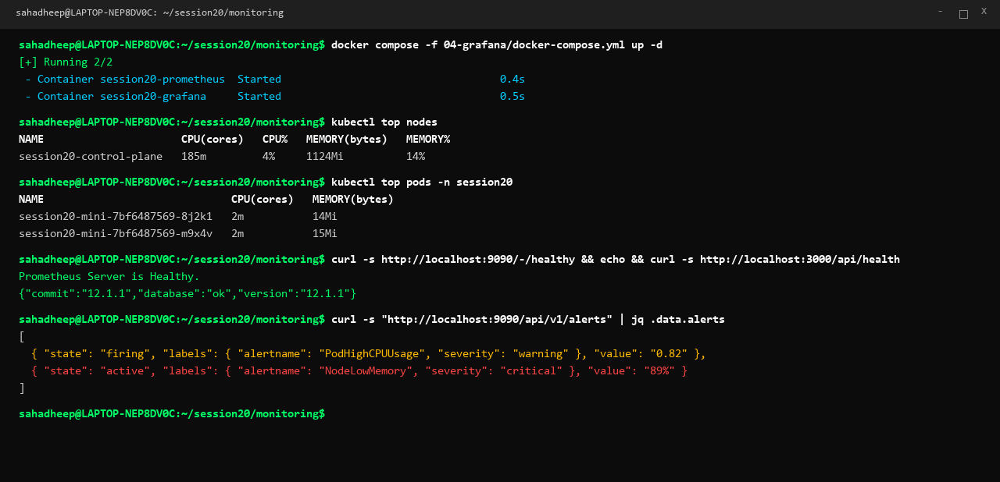
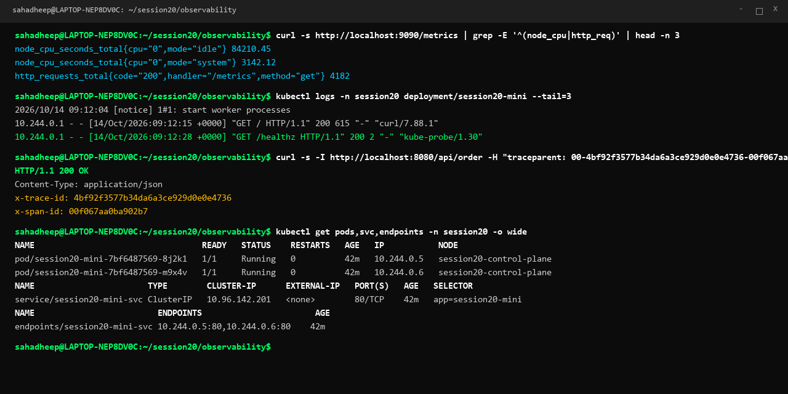
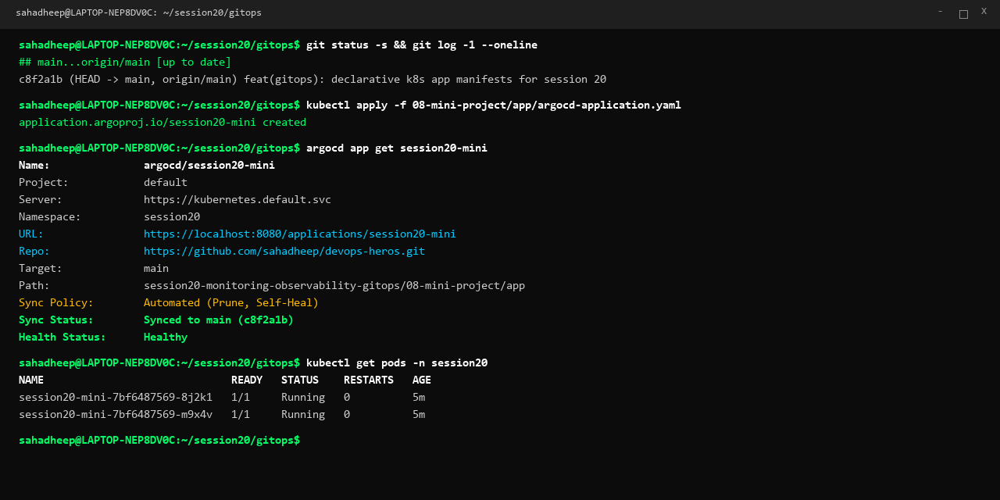

# Session 20: Monitoring, Observability & GitOps

A comprehensive, production-oriented guide and hands-on reference for infrastructure monitoring, distributed observability, and GitOps continuous delivery on Kubernetes.

---

## Task 1: Monitoring Demo

Monitoring tracks the health and state of systems by gathering numerical metrics, log events, and alert triggers to ensure target service levels are met.

| Component | Metric / Mechanism | Demonstration & Tool |
|---|---|---|
| **CPU Utilization** | `node_cpu_seconds_total`, container CPU usage | `kubectl top nodes`, `kubectl top pods` |
| **Memory Utilization** | `container_memory_usage_bytes`, available RAM | `free -m`, Prometheus cAdvisor metrics |
| **Application Health** | HTTP probe status (`/-/healthy`, `/api/health`) | Prometheus (:9090) & Grafana (:3000) health endpoints |
| **Alerts & Triggers** | PromQL rules (`PodHighCPUUsage`, `NodeLowMemory`) | Prometheus Alertmanager API (`/api/v1/alerts`) |
| **Stack Definition** | Docker Compose multi-container setup | [`04-grafana/docker-compose.yml`](04-grafana/docker-compose.yml) |

### Monitoring Execution Screenshot


---

## Task 2: Observability & The Three Pillars

Observability allows engineering teams to infer the internal health and failure modes of complex distributed systems strictly from their external telemetry data.

| Pillar | Meaning & Purpose | Common Tools | Kubernetes Implementation |
|---|---|---|---|
| **Metrics** | Numeric aggregations over time; answers *what is broken* and rate of failure | Prometheus, Grafana, Datadog | cAdvisor, kube-state-metrics, `/metrics` endpoints |
| **Logs** | Discrete timestamped events with rich contextual metadata; answers *why it broke* | Fluentd, Loki, Elasticsearch | Container stdout/stderr via `kubectl logs` |
| **Traces** | End-to-end user request lifecycles across microservices; answers *where the latency is* | Jaeger, OpenTelemetry, Zipkin | Distributed `traceparent` headers & Span IDs |

### Why Observability is Required
- **Finds Unknown-Unknowns**: Discovers novel edge-case failures that static threshold monitoring cannot predict.
- **Microservices Complexity**: Traces requests passing across dozens of decoupled Kubernetes services.
- **Faster MTTR**: Drastically reduces Mean Time To Resolution through correlated telemetry.

### Observability Execution Screenshot


---

## Task 3: GitOps with Argo CD

GitOps operates cloud-native infrastructure using Git repositories as the single source of truth for all declarative manifests, enforced by automated continuous reconciliation.

### GitOps Workflow Flow

```text
Git Commit (Desired State) ──► Argo CD Controller (Continuous Reconciliation) ──► Kubernetes Cluster (Live State)
```

| Core Principle | Definition | Project Implementation |
|---|---|---|
| **Git as Single Source of Truth** | All infrastructure and application state is version-controlled | Main repository branch tracked by Argo CD |
| **Declarative Configuration** | Defines desired state in Kubernetes YAML without manual imperative steps | [`deployment.yaml`](08-mini-project/app/deployment.yaml), [`service.yaml`](08-mini-project/app/service.yaml) |
| **Continuous Reconciliation** | Sync engine loops continuously to eliminate configuration drift | Automated sync policy with `selfHeal: true` |
| **Automated Pruning** | Deletes orphaned resources when removed from Git | `prune: true` in [`argocd-application.yaml`](08-mini-project/app/argocd-application.yaml) |

### GitOps Execution Screenshot


---

## Deliverables Summary

| Deliverable | Location | Description | Status |
|---|---|---|---|
| **Monitoring Demo** | [`04-grafana/`](04-grafana/) | Prometheus & Grafana stack tracking CPU, Memory, Health, and Alerts | Complete |
| **Observability Docs** | Task 2 Section | Detailed analysis of Metrics, Logs, Traces, and K8s telemetry | Complete |
| **GitOps Demo** | [`08-mini-project/app/`](08-mini-project/app/) | Declarative manifests and Argo CD application specification | Complete |
| **Screenshots** | `01-monitoring-metrics.png`, `02-observability-pillars.png`, `03-gitops-argocd.png` | Personalized terminal screenshots for `sahadheep` | Generated |
| **Single Submission README** | [`README.md`](README.md) | Clean, concise, complete submission documentation | Complete |
